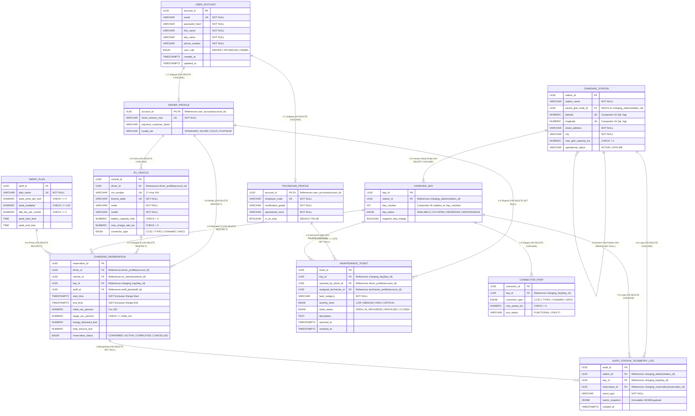
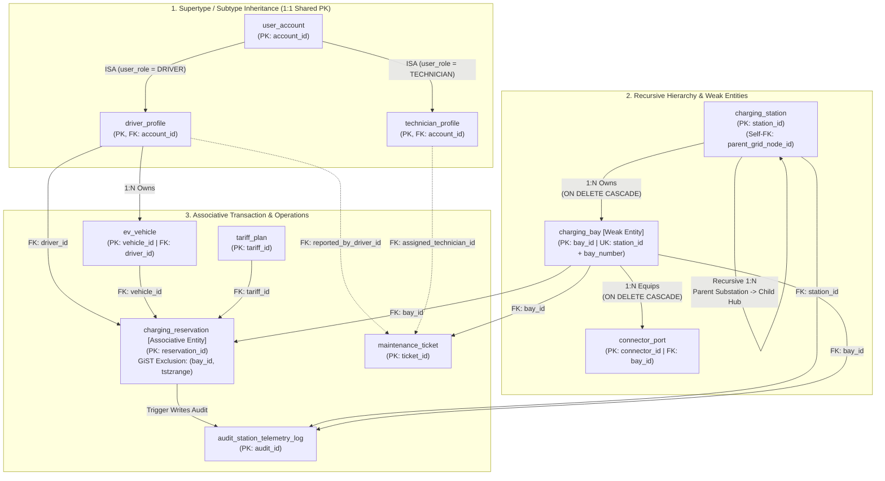
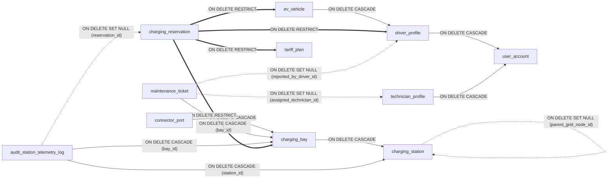
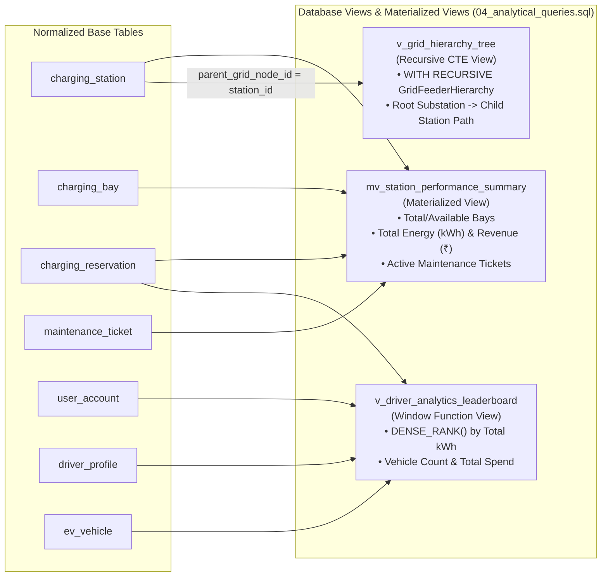

# VoltGrid: Complete DBMS Architecture & ER Diagrams Pack

This document contains all database diagrams required for your DBMS project report and viva presentation:
1. **Complete Entity-Relationship (ER) Diagram** (Crow's Foot Notation — All 11 Tables)
2. **Conceptual EER Hierarchy Diagram** (Supertype/Subtype Inheritance, Weak Entities, and Recursive Relationship)
3. **Foreign Key Referential Integrity & `ON DELETE` Behavior Diagram** (`CASCADE` vs `RESTRICT` vs `SET NULL`)
4. **Database Triggers & Stored Procedure Execution Sequence Diagram**
5. **Views & Materialized View Data Lineage Diagram**

---

## 1. Complete Entity-Relationship (ER) Diagram (All 11 Tables)

---

## 2. EER Conceptual Diagram (Inheritance, Weak Entities & Recursive Hierarchy)

This diagram highlights the **four core relational modeling patterns** used in the schema:
1. **ISA Specialization (Supertype / Subtype Inheritance):** `user_account` $\rightarrow$ `driver_profile` and `technician_profile` (shared Primary Key `account_id`).
2. **Recursive Self-Referencing Relationship:** `charging_station.parent_grid_node_id` $\rightarrow$ `charging_station.station_id` (models regional substations feeding child charging hubs).
3. **Weak / Dependent Entity Chain:** `charging_station` $\rightarrow$ `charging_bay` (identified by `station_id + bay_number`) $\rightarrow$ `connector_port`.
4. **4-Way Associative Entity:** `charging_reservation` connecting `driver_profile`, `ev_vehicle`, `charging_bay`, and `tariff_plan`.

---

## 3. Foreign Key Referential Integrity & `ON DELETE` Rules Diagram

This diagram shows **why** each Foreign Key uses `ON DELETE CASCADE`, `ON DELETE RESTRICT`, or `ON DELETE SET NULL`:
- **`ON DELETE CASCADE` (Green):** Child rows cannot exist without their parent (e.g., deleting a `charging_station` deletes its physical `charging_bay`s and `connector_port`s; deleting a `user_account` deletes its `driver_profile`).
- **`ON DELETE RESTRICT` (Red):** Prevents accidental deletion of financial/billing records (e.g., you **cannot** delete a `tariff_plan`, `charging_bay`, `ev_vehicle`, or `driver_profile` if it is referenced in `charging_reservation`).
- **`ON DELETE SET NULL` (Blue):** Preserves historical tickets/logs even if the referenced user, parent station, or reservation is removed.

---

## 4. Database Trigger & Stored Procedure Sequence Diagram

This sequence diagram shows how **PostgreSQL Stored Procedures** (`03_stored_procedures.sql`) and **Automated Triggers** (`02_triggers.sql`) execute inside the database engine during:
1. **Booking / Completing a Reservation**
2. **Reporting / Resolving a Maintenance Ticket**

```mermaid
sequenceDiagram
    autonumber
    actor User as Driver / Technician UI
    participant API as Express Backend
    participant PG as PostgreSQL 16 Engine
    participant TRG as Automated DB Triggers

    rect rgb(20, 40, 35)
    Note over User,TRG: Flow A: Atomic Slot Booking & Completion
    User->>API: Click "Confirm Booking" (bay_id, vehicle_id, start_time, end_time)
    API->>PG: SELECT * FROM sp_book_charging_bay_atomic(...)
    PG->>PG: 1. SELECT ... FROM charging_bay FOR UPDATE (Row Lock)
    PG->>PG: 2. Verify connector_port compatibility with ev_vehicle
    PG->>PG: 3. Check tstzrange overlap (GiST Exclusion Constraint)
    PG->>PG: 4. INSERT INTO charging_reservation (...) VALUES (...)
    PG->>TRG: Fires AFTER INSERT trigger: trg_audit_reservation_lifecycle
    TRG->>PG: INSERT INTO audit_station_telemetry_log (metric_snapshot JSONB)
    PG-->>API: Return reservation_id & estimated_cost
    API-->>User: Show Confirmed Reservation & Stream SQL
    end

    rect rgb(40, 30, 20)
    Note over User,TRG: Flow B: Maintenance Ticket Hardware Sync Trigger
    User->>API: Report Fault / Run Trial INSERT on maintenance_ticket
    API->>PG: INSERT INTO maintenance_ticket (bay_id, ticket_status='OPEN', ...)
    PG->>TRG: Fires AFTER INSERT trigger: trg_sync_bay_status_ticket
    TRG->>PG: UPDATE charging_bay SET bay_status = 'MAINTENANCE' WHERE bay_id = NEW.bay_id
    PG-->>API: Return ticket row (Bay is now automatically MAINTENANCE)
    User->>API: Resolve Ticket (ticket_status = 'RESOLVED')
    API->>PG: UPDATE maintenance_ticket SET ticket_status = 'RESOLVED' ...
    PG->>TRG: Fires AFTER UPDATE trigger: trg_sync_bay_status_ticket
    TRG->>PG: UPDATE charging_bay SET bay_status = 'AVAILABLE' WHERE bay_id = NEW.bay_id
    PG-->>API: Return resolved ticket (Bay is automatically AVAILABLE again)
    end
```

---

## 5. Analytical Views & Materialized View Lineage Diagram

This diagram shows how the 3 analytical views (`04_analytical_queries.sql`) aggregate data from the normalized tables:

