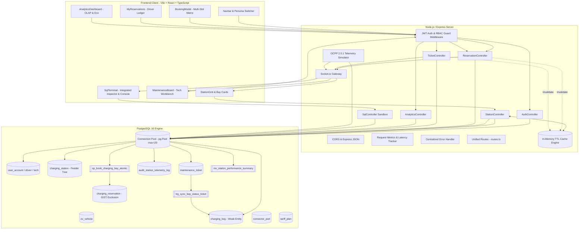

# VoltGrid Architecture & Memory Graph

> **Production Reference & Component Memory Map**  
> Consult this graph to navigate module boundaries, data flows, and state ownership before modifying code.

---

## 1. System Architecture Map

---

## 2. Module Responsibilities & Invariants

### 2.1 Client Layer (`client/src/`)
* **State Management:** React hooks with component-level modularity and local JWT persistence (`localStorage.getItem('voltgrid_token')`).
* **Real-Time Integration:** Single Socket.io client (`api/client.ts`) listening to `bay_status_changed`, `ticket_updated`, `telemetry_stream`, and `sql_executed`.
* **Theme Standards:** Strict adherence to `.agents/rules/ui-and-domain-standards.md` (warm zinc/slate `#09090b` / `#18181b` / `#27272a`, subtle 1px ambient borders, generous breathing room).

### 2.2 API Layer (`server/src/`)
* **`middleware/rateLimiter.ts`:** DoS and brute-force protection using `express-rate-limit` (`authLimiter` for login/quick-login at 20 req/15m; `sqlLimiter` for SQL console at 30 req/m).
* **`controllers/stationController.ts`:** Single-query `jsonb_agg` hierarchy fetch eliminating N+1 queries. Reads through `cache.ts` (30s TTL).
* **`controllers/reservationController.ts`:** Invokes PostgreSQL stored procedure `sp_book_charging_bay_atomic` for atomic validation and pessimistic locking. Invalidates station cache upon booking/cancellation.
* **`controllers/ticketController.ts`:** Handles incident reporting and resolution. Relies on PostgreSQL trigger `trg_sync_bay_status_ticket` to maintain hardware state.
* **`controllers/sqlController.ts`:** Multi-layer hardened sandbox executing queries via isolated `sandbox_readonly` connection pool (`sandboxPool`), controller-level RBAC (`TECHNICIAN`/`ADMIN`), `BEGIN READ ONLY` transactions, `SET LOCAL statement_timeout = '3000'`, and keyword blocklist defense-in-depth.
* **`utils/cache.ts`:** Thread-safe, in-memory TTL caching with deterministic key and prefix invalidation (`delPrefix`).
* **`services/telemetrySimulator.ts`:** Background service simulating physical OCPP 2.0.1 smart EV charger meter values (kW, voltage, current, temperature, frequency). Throttles database audit inserts to load surges (>85kW) and thermal spikes (>40°C) while broadcasting continuous ticks over WebSocket.
* **`scripts/demo_concurrency.ts`:** Live benchmark script executing concurrent identical bookings (`Promise.all`) to demonstrate mathematical GIST exclusion rejection (HTTP 201 Created vs. HTTP 409 Conflict).

### 2.3 Database Layer (`database/`)
* **Concurrency Protection:** Generalized Search Tree (GIST) range exclusion constraint (`btree_gist`):
  $$\text{EXCLUDE USING gist } (\text{bay\_id WITH }=, \text{tstzrange}(\text{start\_time}, \text{end\_time}) \text{ WITH }\&\&)$$
* **Pessimistic Locking:** `sp_book_charging_bay_atomic` runs with `SELECT ... FOR UPDATE` and `SET LOCAL lock_timeout = '3s'`.
* **Least-Privilege Role Isolation:** Dedicated PostgreSQL role `sandbox_readonly` with restricted `GRANT SELECT` privileges and zero DDL/DML capabilities.
* **Normalization:** 100% BCNF compliance with zero insertion, update, or deletion anomalies.
* **OLAP Views:** Recursive CTE `v_grid_hierarchy_tree`, Window functions `v_driver_analytics_leaderboard`, and Materialized view `mv_station_performance_summary` with concurrent unique-index refresh.

---

## 3. Data Flow & Mutation Lifecycles

### Flow A: Driver Books a Charging Bay
1. User selects date and 2-hour window in `BookingModal.tsx`.
2. Client dispatches `POST /api/reservations/book` with JWT bearer token.
3. `authMiddleware` validates JWT signature and assigns `req.user`.
4. `reservationController` validates payload via Zod schema (`bookSchema`).
5. `sp_book_charging_bay_atomic` acquires row-level lock on `charging_bay` (`FOR UPDATE`).
6. Port compatibility verified (`connector_port.connector_type = ev_vehicle.connector_type`).
7. GIST exclusion constraint validates range non-overlap.
8. Row inserted into `charging_reservation`.
9. `reservationController` invalidates `stations:all` cache and emits `bay_status_changed` via Socket.io.
10. All connected client UIs reflect `RESERVED` status in real-time.

### Flow B: Hardware Incident Resolution
1. Driver or tech files ticket: `POST /api/tickets`.
2. PostgreSQL trigger `trg_sync_bay_status_ticket` automatically flips `charging_bay.bay_status` to `'MAINTENANCE'`.
3. Station cache evicted; Socket.io broadcasts `MAINTENANCE` status.
4. Assigned technician clicks "Resolve Ticket": `PATCH /api/tickets/:id/resolve`.
5. Trigger checks for remaining open tickets on bay; if none, automatically restores `bay_status` to `'AVAILABLE'`.
6. Socket.io broadcasts `AVAILABLE` status.
